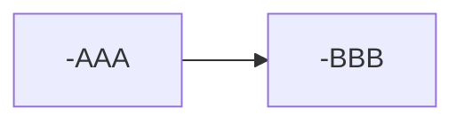

# Ticket templates

The body of every ticket `file-ticket` writes. Short beats complete: drop a section with nothing to say, never write "none". The blocks under Tracker templates are the fullest shape; the writer deletes the headings it does not fill.

## Shared core (every type)

```markdown
## Goal

<One sentence: the outcome once this ships.>

## Why

<1 to 3 lines, with one sourced figure: a log query, a trace id, a monitor row, a measured count.>

## Done when

- [ ] <A checkable item. The PR's `## Done` copies these items and ticks each with its evidence.>
```

- **Figures first.** A Why carries a number and where it came from. A Bug with no evidence is a Spike.
- **No restating.** Link a glossary term to `docs/glossary.md` rather than defining it again; a Design never restates the Goal.
- **Lines.** Every `path:line` names the trunk sha it was read on.
- **Length.** The Goal and the Why hold about 150 words of prose between them.

## Type and size

The type is the ticket's tracker label (one of 7); the estimate is its points, 1, 2, 4, 8 or 16, set on every ticket. The extras follow the type, never the points. Points gate two things only: 4 points always carries a Design, and 8 or more is split unless the ticket is an Epic. A type's Design column adds to the 4-point rule, and three triggers apply to every type: the work spans more than one PR (then it is an Epic), it changes a contract, or its approach is uncertain. This table is the source: a tracker block that drifts from it is the one to fix.

| Type | Design | Extras |
| -- | -- | -- |
| Bug | At 4 points | `## Repro`, `## Cause` (`path:line` at a trunk sha) |
| Feature | Yes | |
| Improvement | At 4 points, or when it moves a seam | `## Before / After` table |
| Chore | At 4 points | `## Scope` (in / out) |
| Chore, Ops variant | At 4 points; it is a checklist | `## Steps` (numbered, who runs each), `## Rollback` |
| Documentation | At 4 points | |
| Spike | At 4 points; it ends in a finding or tickets | `## Question`, `## Method`, `## Budget` (hours or $) |
| Spike, Eval variant | Yes; its cost table needs the user's go | `## Arms`, `## Metric`, `## Runs`, `## Cost`, `## Decision rule` |
| Epic | No; its slices carry Designs | `## Slices` table (ticket, status), a mermaid order diagram |

A variant is the Ops or Eval form of a Chore or Spike, not a label of its own; its extras replace the type's. The Design's own shape is `.claude/skills/agent-workflow/DESIGN.md`.

## Tracker templates

One block per type, in full so the user can paste each into the tracker's own template settings.

### Bug

```markdown
## Goal
## Why
## Repro
1.
## Cause
`path:line` at trunk `<sha>`
## Done when
- [ ]
```

### Feature

```markdown
## Goal
## Why
## Done when
- [ ]
## Design
```

### Improvement

```markdown
## Goal
## Why
## Before / After
| Before | After |
| -- | -- |
## Done when
- [ ]
```

### Chore

```markdown
## Goal
## Why
## Scope
In:
Out:
## Done when
- [ ]
```

### Chore, Ops variant

```markdown
## Goal
## Why
## Steps
1. <step> (<who runs it>)
## Rollback
## Done when
- [ ]
```

### Documentation

```markdown
## Goal
## Why
## Done when
- [ ]
```

### Spike

```markdown
## Goal
## Why
## Question
## Method
## Budget
## Done when
- [ ] A finding, or the tickets it files
```

### Spike, Eval variant

```markdown
## Goal
## Why
## Arms
## Metric
## Runs
## Cost
| Arm | Cells | ~$ |
| -- | -- | -- |
## Decision rule
## Done when
- [ ]
## Design
```

### Epic

~~~markdown
## Goal
## Why
## Slices
| Ticket | Status |
| -- | -- |



## Done when
- [ ] Every slice Done
~~~
